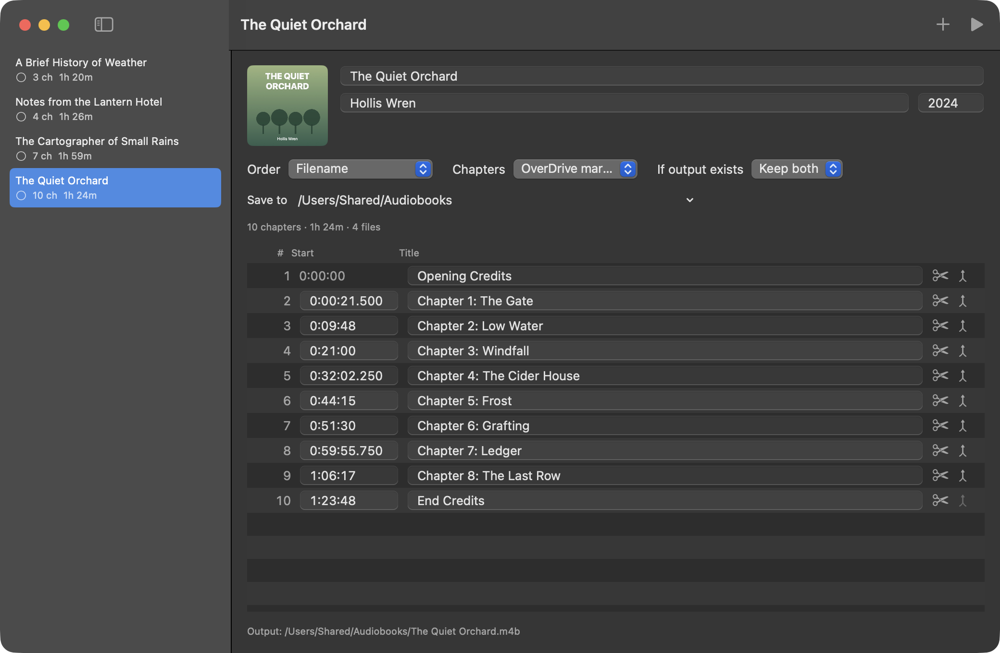

# M4B Converter

MP3 to M4B audiobook converter for Mac. Drop in folders of MP3s and get single,
chaptered `.m4b` files for Apple Books, Audiobookshelf and other audiobook players.



[](LICENSE)
[](https://ko-fi.com/greenglasst)

- **Batch it.** A folder of MP3s is one book, a folder of folders is several, and three convert at a time.
- **Chapters that make sense.** Taken from OverDrive markers, one per file, or a filename pattern, then editable in place: rename, retime, split, merge.
- **Metadata filled in for you.** Title, author and year come from the MP3 tags, the cover from an image in the folder, and all of it is editable before converting.
- **Every output is verified.** Each `.m4b` is re-probed against the chapters and length it was meant to have before it's marked done.
- **Check books you already have.** Point it at existing `.m4b` files to find ones that are cut short or corrupt.

## Install

1. Download the latest `M4BConverter-*.zip` from
   [Releases](https://github.com/GreenglassT/M4BConverter/releases/latest), unzip it,
   and move **M4B Converter** to Applications. The app is signed and notarized.
2. Install ffmpeg, which does the actual encoding: `brew install ffmpeg`

Requires macOS 14 or later.

## Build from source

```bash
./Scripts/make-app.sh      # produces "M4B Converter.app" (ad-hoc signed)
swift test                 # runs the suite
```

`make-app.sh` reads `VERSION`, `BUILD_NUMBER`, `BUNDLE_ID` and `SIGN_IDENTITY`
from the environment; see the top of the script.

## How it works

Drop folders on the window. Each folder containing MP3s becomes one book; a
folder of folders becomes several. The app infers file order, chapter source and
metadata, shows you what it chose, and converts three books at a time. Every
output is re-probed and verified before it is marked complete.

## Chapters

Chapters are normally derived: the Chapters picker names a source — OverDrive
markers, one per file, or a filename pattern — and the table shows what that
produces. Edit any of it and the list becomes yours instead. Titles and
boundaries are typed in place (`h:mm:ss`, or `h:mm:ss.mmm`), Return moves to the
next field, and every row can be split in two or merged into the one below it.
The time between two chapters is one value rather than two, so an edit cannot
leave a gap or an overlap, and the book's own start and end are fixed.

From then on the list is marked "edited by hand" and nothing regenerates it
behind your back — not the Order or Chapters pickers, and not the conversion,
which re-plans a derived list from the durations it measures but converts an
edited one as it stands. Changing either picker asks first and says what would be
lost; "Revert to Automatic" hands the job back to the picker deliberately.

## Checking books you already have

File ▸ "Check Existing Books…" (⇧⌘K) takes `.m4b` files, or folders of them, and reports on
each one. It asks a different question from the one asked of a conversion, and the
difference is the whole design: every check the converter makes is **relative** — this many
chapters, this many seconds, both taken from the source MP3s it measured minutes earlier. A
file that arrived from a shop, a rip or another tool has no such expectation attached, and
inventing one would only produce confident wrong answers. So this asks only what a file can
be asked about itself.

Two findings mean the audio is wrong, and are called **damage**:

- **It decodes shorter than its container claims.** The important one, and the only check
  here that needs nothing at all to compare against. A container saying 20.0 s over 18.0 s
  of real audio, with ffmpeg exiting 0 and nothing anywhere saying the end of the book is
  gone, is exactly the defect this exists to find. The allowance for ordinary metadata
  drift is the converter's own — `min(max(1 s, 0.5%), 10 s)`, measured against 448 real
  files — not a second rule.
- **The decode complained more than one file can explain.** Catches what the length check
  cannot: a corrupt middle, where every packet still carries its timestamp, so the file
  decodes to exactly the right length while the audio inside it is rubbish.

No audio stream at all, and chapter marks that do not advance, are damage too: the file is
unplayable or unnavigable. Missing chapters, missing cover art and a missing `media_type`
tag are reported as **findings** — the audio is complete and correct, and each is fixable
in a tag editor. It is the same split the converter already draws between failing a book
and simply noting something about one.

Books are decoded several at a time — how many is the machine's core count minus the share
the conversion queue keeps, since a check may run alongside a conversion and each of these
processes wants a whole core to itself. The run is cancellable, choosing more books adds to
the results rather than replacing them, and the results copy or save as plain text (a copy
taken mid-run says so, and lists what has not been checked yet). Nothing is written, moved
or deleted; the files are only read.

## Where the files go

By default each `.m4b` is written beside the folder it came from, which for a
book nested inside a box set means inside that box set. Settings (⌘,) sets one
folder for every book instead, and the inspector's "Save to" row overrides it for
a single book. Two books with the same title landing in one folder no longer have
different parent folders to keep them apart, so the second is saved as
"Title 2.m4b" — or replaced or skipped, per the book's "If output exists" policy.

## Reclaiming the source MP3s

Once a book has converted, its MP3s are usually dead weight beside the `.m4b`.
"Reclaim Source MP3s…" — in the inspector and in the queue's context menu — moves
that book's source folder to the **Trash**. It is never automatic: it is offered
only for a book that has converted and verified, it always takes a confirmation
naming the folder, how many files, how much space and anything in there that is
not the book's own tracks or cover, and there is deliberately no "always reclaim
after converting" setting.

If the folder holds **another book from the queue** — its MP3s, its finished
`.m4b`, or both — the confirmation names that book first, by title, and says that
it goes to the Trash too. This happens when a parent folder and one of its
children were dropped separately, and it is a warning rather than a refusal: the
folder goes to the Trash whole, so everything in it can be put back, and the user
may well mean it. The other book keeps whatever status it had, so it will still
show as verified afterwards.

Nothing is deleted, ever. If the volume has no Trash the reclaim fails and says
so rather than falling back to removing the files. Immediately before the folder
moves — not from the earlier run's verdict — the app confirms that the finished
file is still where it was written, that it is not inside the folder about to go,
and that it still verifies against this book's chapter count and length. Anything
that does not match keeps the MP3s and reports why.

A reclaimed book stays in the queue as the record of what was made: it will not
convert again, it cannot be retried, and its settings are closed. Put the folder
back from the Trash and drop it on the window to work on it again.

## Support

M4B Converter is free and MIT licensed. If it saved you an evening of fiddling
with chapter files, you can [buy me a coffee on Ko-fi](https://ko-fi.com/greenglasst).
Bug reports and pull requests are welcome.

## License

MIT. See [LICENSE](LICENSE). ffmpeg is installed separately and is not bundled.
